# Diffusion Model + VIT for Small-Sample Fault Diagnosis, Python Code

In recent years, if you've been paying attention to top conference papers or generative AI, you must have heard of the name DDPM (Denoising Diffusion Probabilistic Model).
Since the groundbreaking paper by the team at UC Berkeley was published in NeurIPS, this once niche model has completely reshaped the landscape of generative models:
It is the underlying core of phenomenal AI painting tools like Stable Diffusion, DALL E3, and Midjourney, allowing AI-generated images to achieve "deception" for the first time;
In the academic community of top conferences, it has replaced the once "top-tier" GAN as a new benchmark in the field of generative models - just in the year 2023-2024 alone, the number of papers related to diffusion models in NeurIPS and ICML surged by 300%, covering almost all areas from image generation to scientific computing, from medical imaging to industrial AI;
More importantly, it perfectly addresses the old pain points of previous generative models: GAN training instability and vulnerability to mode collapse, VAE generation of samples being blurry, while DDPM achieves stable training, high quality generation, and strong diversity with its "stepwise noise addition - stepwise noise removal" minimalist framework.
This issue aims to utilize this top-tier "favorite" in our work—small sample fault diagnosis.
🚨 Pain Point: Fault samples are always insufficient
Those who have worked on fault diagnosis know a real challenge: there are mountains of data that are running normally, but only a few fault data available.
Devices cannot collect data daily due to their maintenance, and some severe faults may occur only once or twice throughout their entire life cycle. Each type of fault has only 5~20 samples, can the trained model be used?
Today, we share a complete project - generating high-quality synthetic fault samples using the diffusion model (DDPM) to significantly improve diagnostic accuracy under extreme small sample conditions.
The project is based on the CWRU West Storage University bearing dataset. Under extreme small sample conditions where only 5/10/20 samples per class exist, the vibration signals are transformed into time-frequency diagrams through Continuous Wavelet Transform (CWT). Subsequently, three generative models - DDPM diffusion model, WGAN-GP, and VAE - are used to learn the distribution of fault data and generate synthetic samples to expand the training set. The fault diagnosis is then conducted using a Vision Transformer classifier. Comprehensive comparative experiments across multiple dimensions such as accuracy, FID, IS validate that DDPM outperforms GAN and VAE in terms of generation quality, diversity of samples, and diagnostic performance, especially when dealing with extremely scarce samples.
🧭Technical roadmap:
\n        \n      Specifically:
\n        Conversion of one-dimensional vibration signals to two-dimensional RGB time-frequency diagrams through Continuous Wavelet Transform (CWT)
\n        Learning the data distribution of various fault time-frequency diagrams using conditional DDPM
\n        Generating a large number of high-quality synthetic samples starting from very few real samples
\n        Synthetic samples + real samples together train the classifier to complete fault diagnosis
\n        Produce rich visualization graphics highlighting the advantages of DDPM
⚙️Experimental setup:
**Dataset**: CWRU West Storage University bearing data
**Fault categories**: 10 classes (normal + rolling element / inner ring / outer ring × three severity levels)
**Small sample settings**: Each class trained with only 5/10/20 samples respectively
**Classifier**: Vision Transformer (ViT), significantly degrades performance under extremely low sample conditions
**Evaluation metrics**: Classification accuracy, FID (generation quality), IS (generation diversity)
Experiment results:
Here are three experimental cases, 5-shot, 10-shot, and 15-shot refer to selecting only 5, 10, or 15 samples for data augmentation per class before classification.
1. DDPM is truly impressive!
Visualization results are displayed below, showing all the visualization processes of the code can run out!
1. The diffusion process visualization shows the forward diffusion process of DDPM - a clear CWT time-frequency diagram how to be gradually added noise until it becomes pure noise:
2. The inverse denoising process - from a bunch of random noise, after 1000 steps of denoising, gradually draws a fault time-frequency diagram:
3. It can be clearly seen that DDPM is not one step at a time, but like an artist, "carve" the image details from coarse to fine.
2. Sample quality comparison compares the time-frequency graphs generated by three methods:
1. The first row is the real sample, and the rest are the generation results of DDPM, GAN, and VAE. It's obvious:
DDPM: texture is clear, frequency distribution is highly consistent with the real sample
GAN: some categories are still acceptable, but some appear pseudo images
VAE: overall is blurred, losing high-frequency details
3. Generated diversity comparison, DDPM and GAN each generate 8 samples for the same type of fault:
1. DDPM generates 8 different pictures, maintaining intra-class diversity; while GAN tends to generate highly similar patterns under small samples - this is an intuitive manifestation of mode collapse.
4. t-SNE feature distribution uses t-SNE dimensionality reduction to observe the distribution of generated samples in the feature space:
1. Real samples: clusters of various types are clearly divided
DDPM generates: distribution aligned with the real samples
GAN/VAE generates: some categories overlap or offset
The samples generated by DDPM not only "look like" but also are consistent with the real data distribution at the feature level.
5. Diagnostic Accuracy Comparison - This is the most critical result - how much does data augmentation improve diagnostic performance?
Here are three experiments, 5-shot, 10-shot, and 15-shot, which refer to selecting only 5, 10, or 15 samples from each category of faulty samples for data augmentation before classification.
\n Conclusion:
No Aug: ViT performs poorly under very few samples.
VAE Enhancement: There is a certain improvement, but it is limited by the quality of generation.
WGAN-GP Enhancement: Moderate improvement, unstable under small sample size.
DDPM Enhancement: Optimal under all settings, with the most significant improvement in 5-shot.
The more rarity of the sample extreme scene, the more obvious advantage of DDPM.
6. Detailed confusion matrix
The classification results for each category of failures with only 10 samples are as follows: Without data augmentation:
VAE Enhancement:
\n        \n  
GAN Enhancement:
\n        \n  
DDPM Enhancement:
\n        \n  
It can be observed that after the enhancement of DDPM, the classification accuracy of various types of faults has been improved.
---  
7. Accuracy radar charts for various categories
The radar chart intuitively demonstrates the diagnostic accuracy of each category of faults. The enhanced DDPM with red contours is significantly "fuller" than other methods, achieving high levels in almost every category.
\n        \n  
Code Directory:
\nIn the readme, there is a detailed guide on how to use the code. Don't worry about not knowing how to use it! Even beginners can easily run it.
💡 Summary of this project demonstrates that DDPM can "learn" the fault data distribution from a small amount of samples, generating realistic and diverse synthetic data. Compared to the instability of training in GANs and the generation blurriness of VAEs, DDPM exhibits overwhelming advantages in scenarios with limited samples.  
This project provides complete working code, including data preprocessing, model training, experimental evaluation, and visualization in full. It is ready to use out of the box, with one-click replication.

## Images

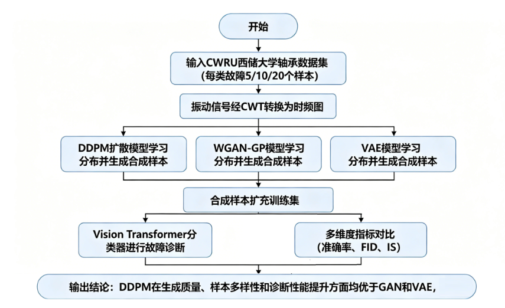
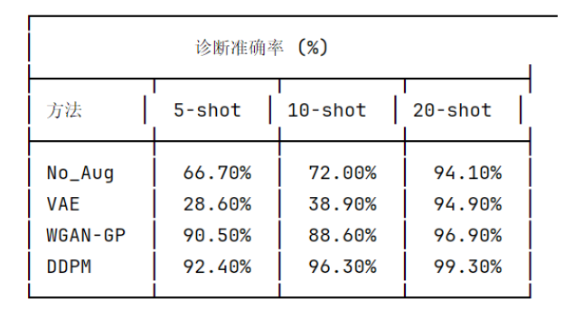
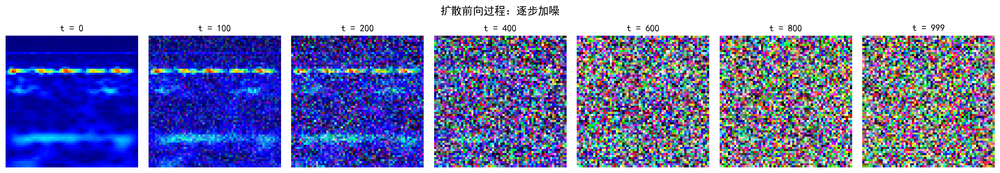
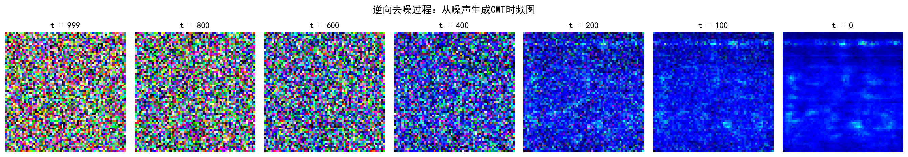
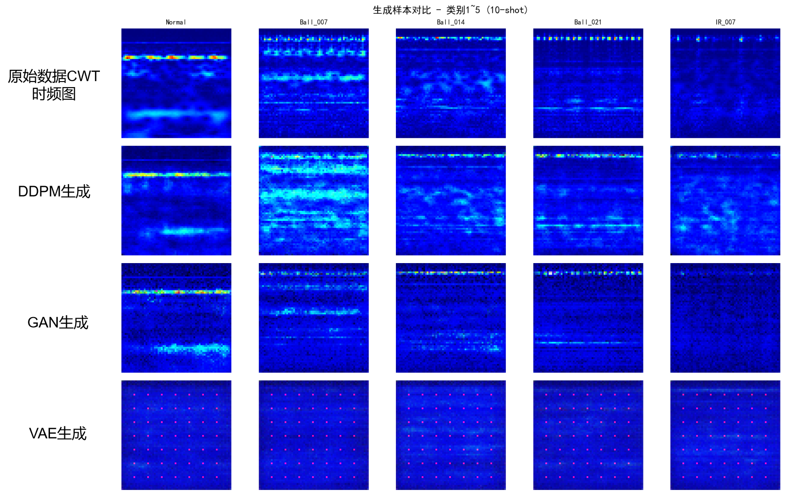
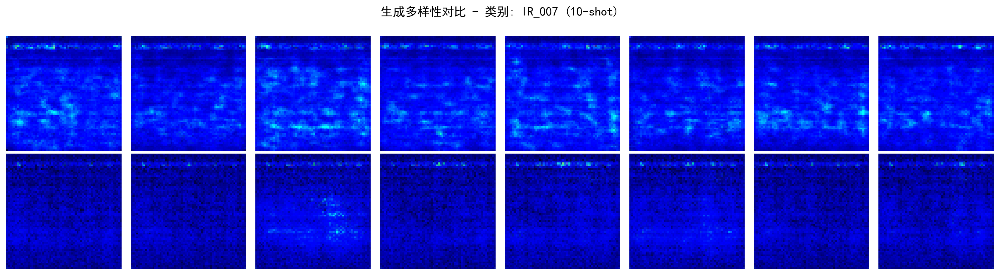
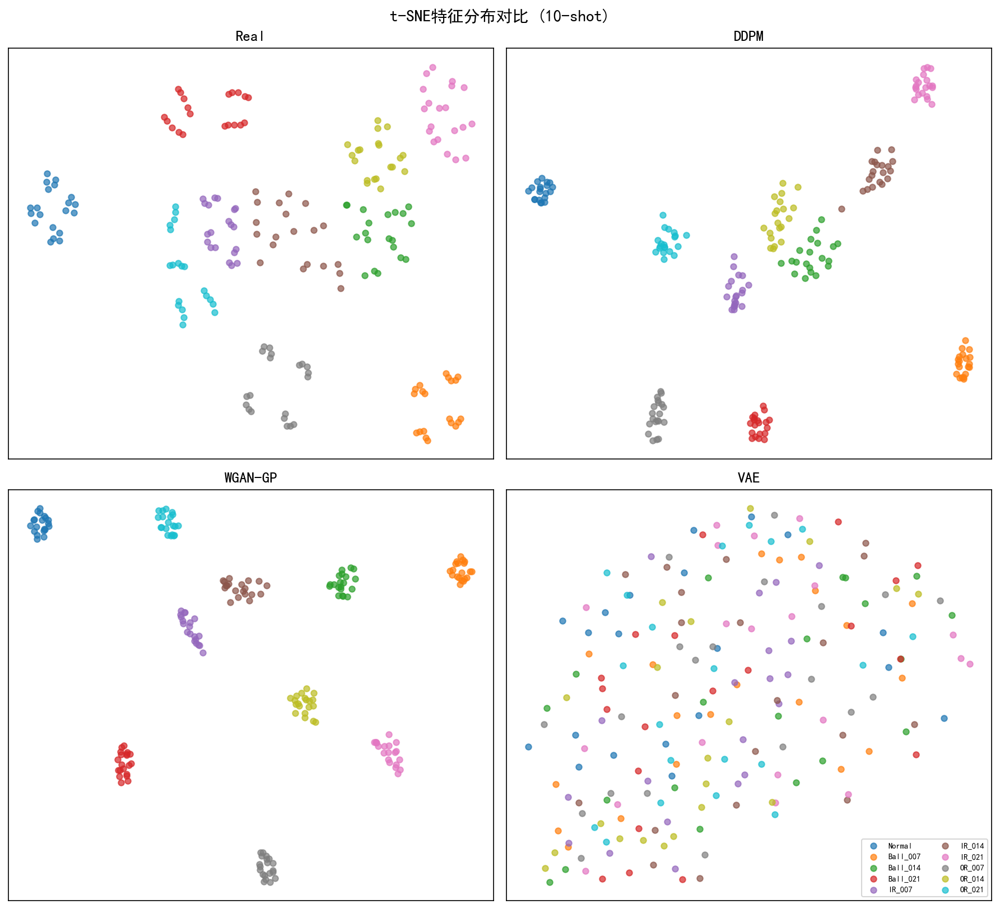
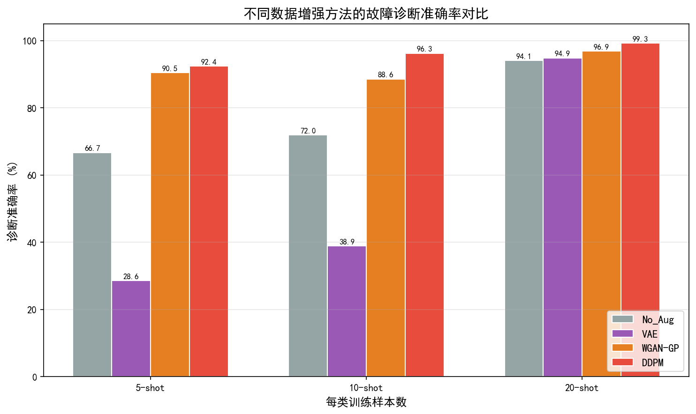
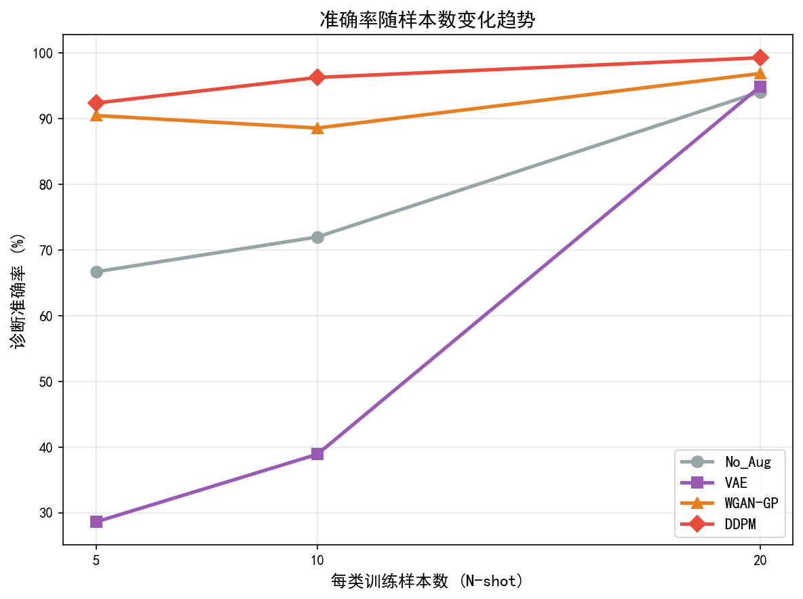
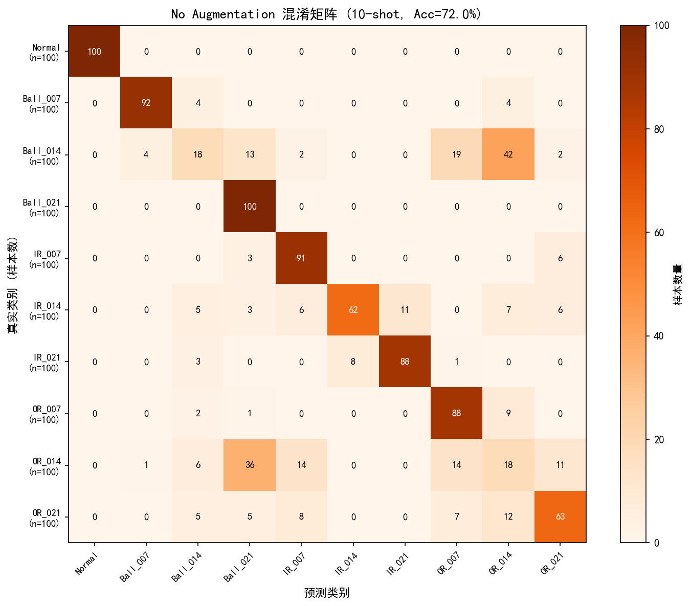
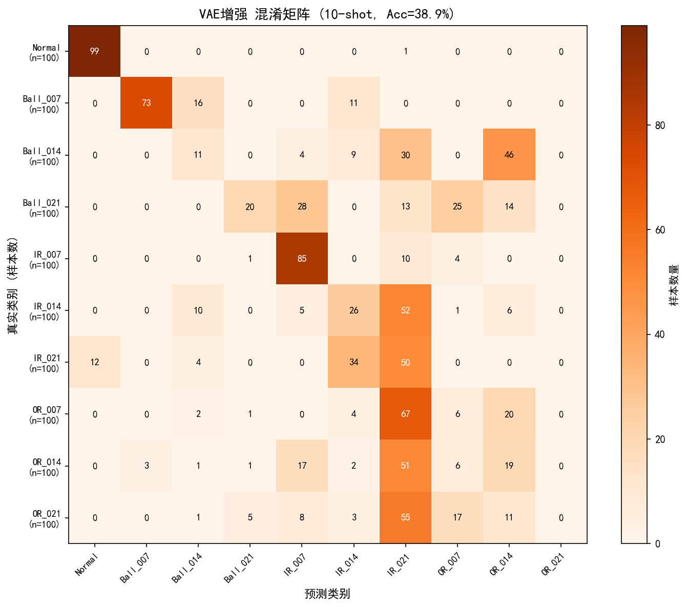
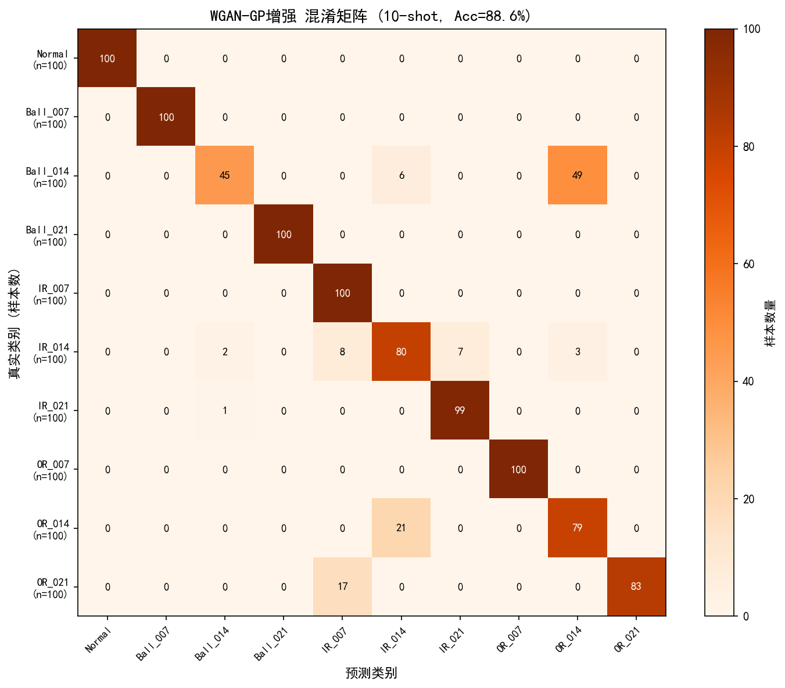
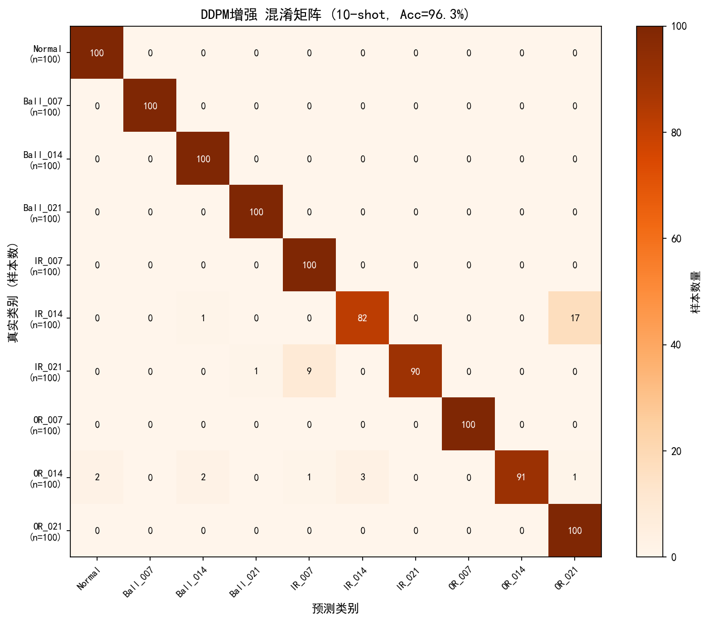
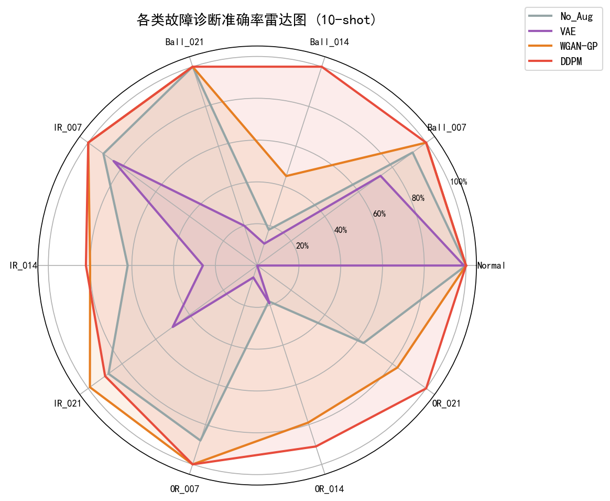
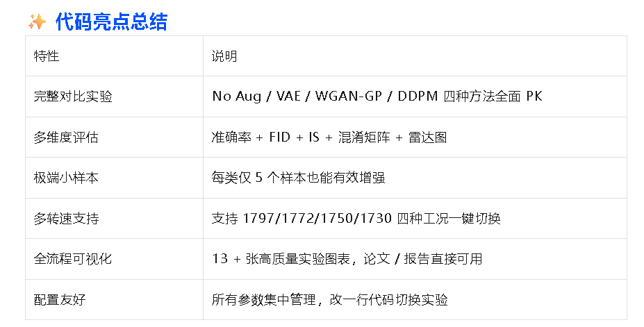
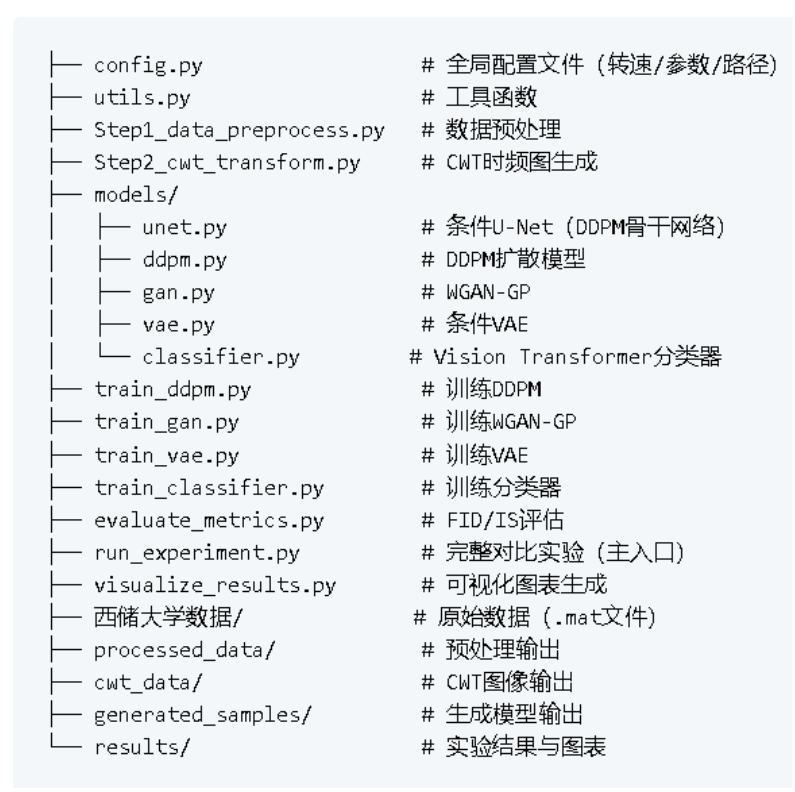

<!-- PAYMENT_BLOCK -->

## Get this dataset

- Payment link (Stripe): [Buy now](https://buy.stripe.com/3cs8yP7sY87d0vu9AB)
- Payment QR code: 

<!-- /PAYMENT_BLOCK -->
